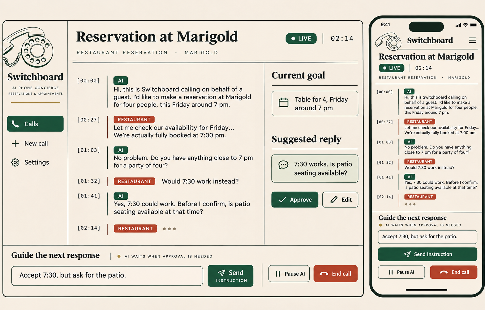

# Switchboard · CSC 4330 Project 6

A base template for an AI phone concierge: restaurant reservations and appointment scheduling, with a live transcript, suggested replies and private instructions during a call.



**Current behavior:** responsive Expo goal entry/review, explicit call-draft saving, and a labelled design preview. The Go API provides health, local sessions and private call create/read endpoints backed by optional PostgreSQL. Creating or opening a draft never dials. [Call-service setup and evidence](packages/go/handlers/calls/README.md) describes database migrations, same-site browser configuration and tests; live conversation features remain separate issues.

## Start

Install [proto](https://moonrepo.dev/docs/proto/install), then:

```sh
proto install
pnpm install --frozen-lockfile
moon run mobile:web
```

In a second terminal: `moon run api:dev`. The API listens on port 8080; `GET /health` returns `{"status":"ok","mode":"template"}`. The preview works without the API. Settings includes an optional readiness check.

For native development use `moon run mobile:dev`, or `moon run mobile:android` / `moon run mobile:ios` with the appropriate Android SDK / Xcode installed. For a phone or Android emulator set `EXPO_PUBLIC_API_URL` as documented in `.env.example`. Expo loads the app's local environment; the Go baseline reads shell environment variables directly. Do not copy server secrets into the mobile app.

## Check

```sh
moon run :build :lint :typecheck :test
```

CI uses the same command and a frozen pnpm lockfile. The baseline needs no Docker and no API keys. The optional database lives in docker/compose.yml. Real calling comes later and requires separate provider accounts and usage billing.

## Work from an issue

Read [AGENTS.md](AGENTS.md), [contracts](docs/contracts.md), [architecture and provider research](docs/architecture.md), [design](docs/design.md), and your issue. Use one branch and PR per issue. Keep the assigned scope and include real verification output. Claude Code and Codex share the same instructions.

The [development plan](docs/development-plan.md) assigns 50 tasks to five people, two tasks per person per stage. `scripts/issues.json` is the reproducible source; the publication report records actual GitHub issue numbers and assignees.

## Layout

The Project 5 structure is retained with its food-specific code and dependencies removed:

```text
apps/         Expo mobile/web preview and Go API
packages/     Shared Go handlers and TypeScript API client
db/           Future migrations
docker/       Optional local Postgres
proto/        Contract boundary and migration note
docs/         Mockup, contracts, research and development plan
scripts/      Issue manifest and publication report
.moon/        Shared tasks and project graph
.github/      CI, issue and PR templates
```

The source reference is [csc4330_project5](https://github.com/bengutow1/csc4330_project5). Project 6 preserves its organization and issue-writing style; it does not copy its history, secrets, product data or unrelated dependencies.
