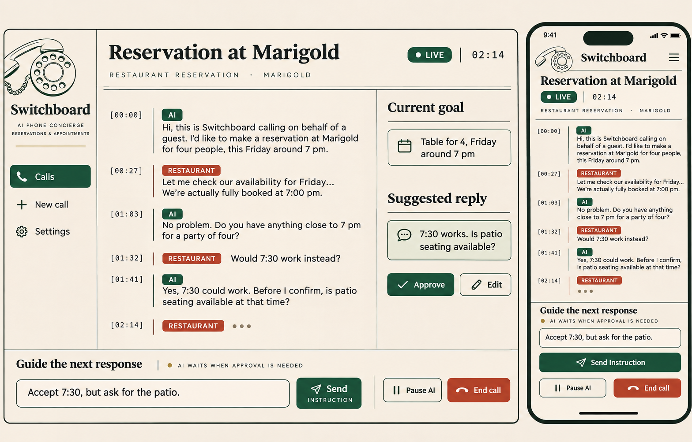

# Switchboard design

Generated with the built-in imagegen tool on November 5, 2026. This image is a visual reference, not a claim of working calls. The starter implements its layout as Expo/React Native code. It labels all simulated behavior.

## Direction

An editorial telephone concierge: warm paper, ink, forest green, a restrained vermilion for the remote speaker and ending a call, brass for secondary status. Thin rules and a strong type hierarchy replace a dashboard grid. Serif headings, familiar body type, small monospaced timestamps. No purple gradients or decorative AI orbs.

Tokens live only in apps/mobile/src/theme.ts. Paper #F5F0E6, ink #202923, forest #234D3C, vermilion #C65036, brass #94733A. Fonts use platform serif/system/mono fallbacks, so the template needs no downloaded fonts. Buttons have at least a 48 px target.

## Screens and routes

The template has one route with local preview navigation. Issue implementations introduce these routes:

| Code | Route | Purpose |
| --- | --- | --- |
| H1 | / | Recent calls, active call and New call |
| N1 | /new | Restaurant or appointment goal, destination, constraints |
| N2 | /review | Review recipient, goal, call mode and disclosure before dialing |
| L1 | /calls/[id] | Live transcript, current goal, suggested reply and steering |
| H2 | /calls/[id]/summary | Outcome, confirmed details and transcript |
| S1 | /settings | Mode, provider availability and retention, never raw keys |

L1 is the primary view. At wide widths use a slim sidebar, a large transcript, and a narrower goal/reply rail. At narrow widths stack these with a reachable instruction composer, keeping transcript reading position stable. AI and business turns have speaker names and timestamps, never color alone. Show provisional text separately from finalized turns.

The operator can type a private instruction, inspect a revised suggestion, edit it, and approve it. Suggested text must not appear in the transcript as spoken until playback is confirmed. Mid-call unknowns need a clear approval state. Display instruction pending/applied/stale/failed states. Pause AI and End call stay reachable.

## Source prompt

Use case: ui-mockup. A mobile-first AI phone concierge named Switchboard for restaurant reservations and appointments. Show desktop and narrow mobile live-call workspaces. Editorial telephone exchange aesthetic: ivory paper, dark ink, forest green, restrained vermilion and brass; thin ruled borders; serif headings, humanist body, monospaced timestamps. Reservation at Marigold, transcript with AI and Restaurant labels, current goal table for four Friday around seven, editable suggested reply, Approve, instruction composer with “Accept 7:30, but ask for the patio,” Pause AI and End call. Avoid generic card grids, purple gradients and glowing AI orbs. Flat crisp interface reference.
